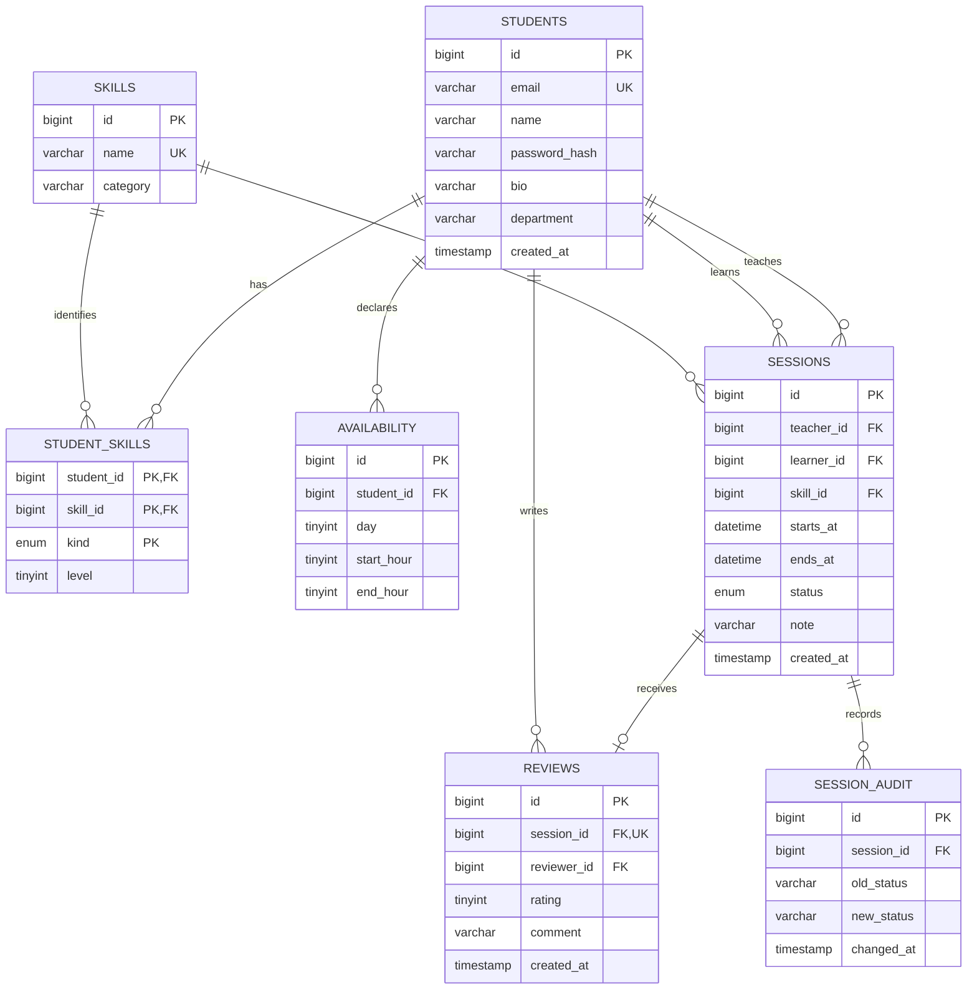

# Student Skill Exchange Platform — ER model
Group: PES2UG24AM027, PES2UG24AM043

Relational schema:
- Students(**id**, name, email UNIQUE, password_hash, bio, department, created_at)
- Skills(**id**, name UNIQUE, category)
- StudentSkills(**student_id, skill_id, kind**, level)
- Availability(**id**, student_id, day, start_hour, end_hour); unique student/day/start/end
- Sessions(**id**, teacher_id, learner_id, skill_id, starts_at, ends_at, status, note, created_at)
- Reviews(**id**, session_id UNIQUE, reviewer_id, rating, comment, created_at)
- SessionAudit(**id**, session_id, old_status, new_status, changed_at)

Each attribute contains one value (1NF). Skill descriptions are independent of student-skill associations, avoiding partial dependencies (2NF). Names and departments are stored on students rather than copied to sessions; skill categories are stored on skills (3NF). Teacher and learner reference the same student entity in different roles. A student can offer and learn the same skill; kind is therefore part of the composite key.

Availability uses UTC, Sunday=0, and whole-hour windows. Sessions use UTC timestamps and half-open intervals [start,end). Rating averages are calculated in a view, avoiding stored aggregate inconsistencies. Pending requests reserve time until accepted or cancelled. Reviews have a unique session key and an insert trigger checking the learner and completed status.

